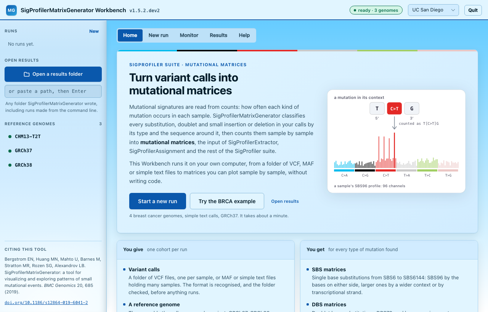
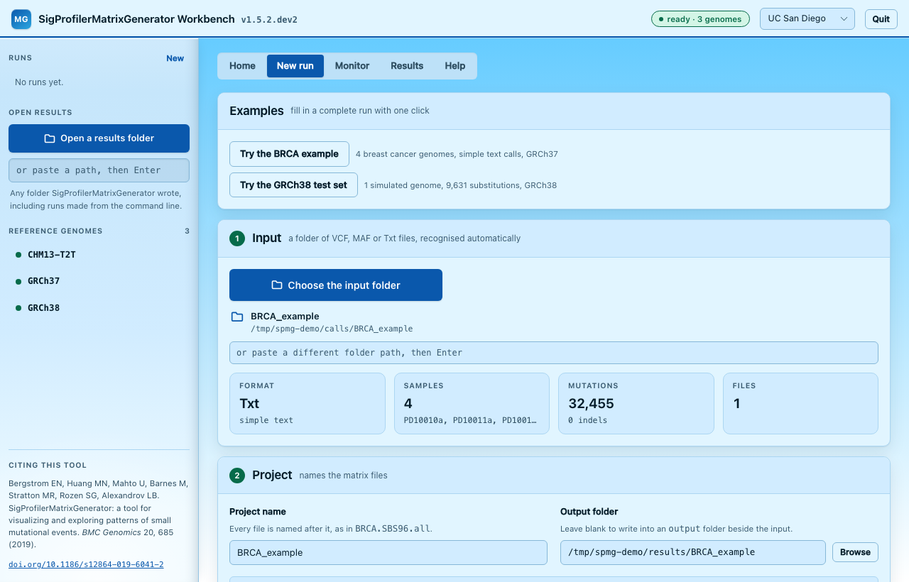
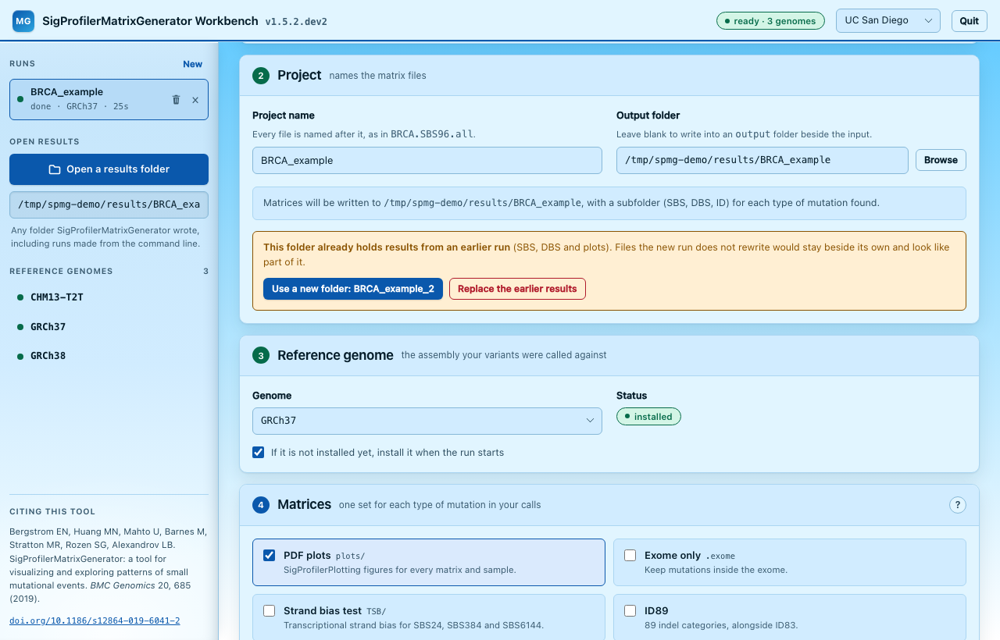
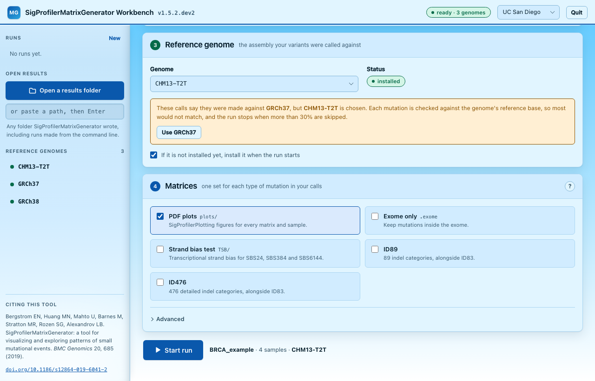
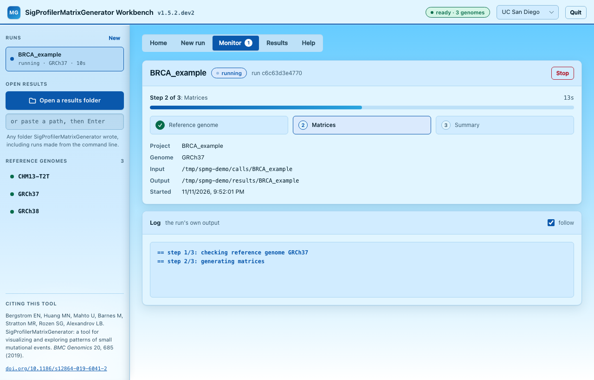
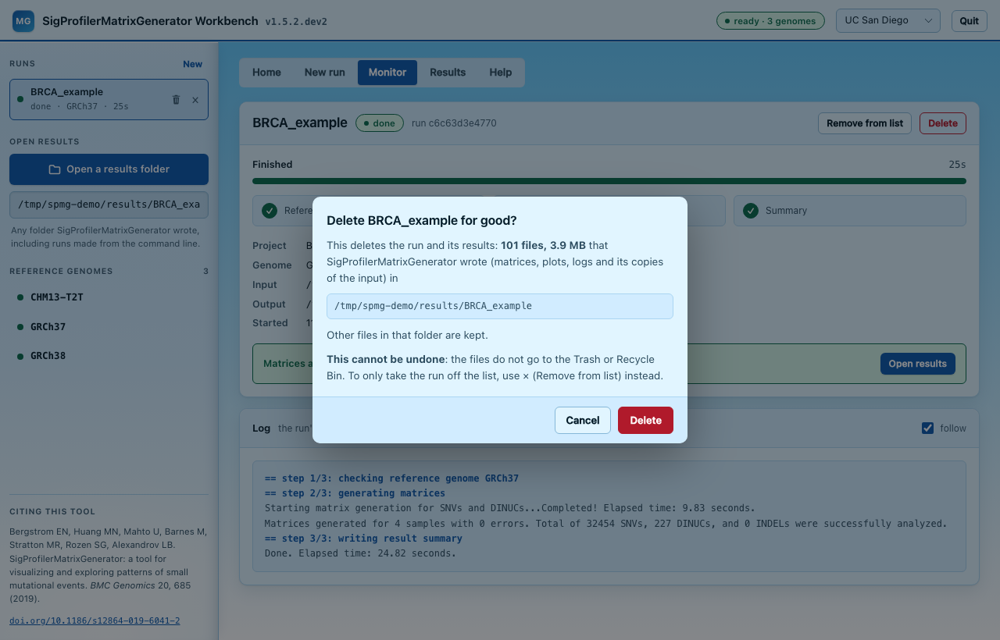
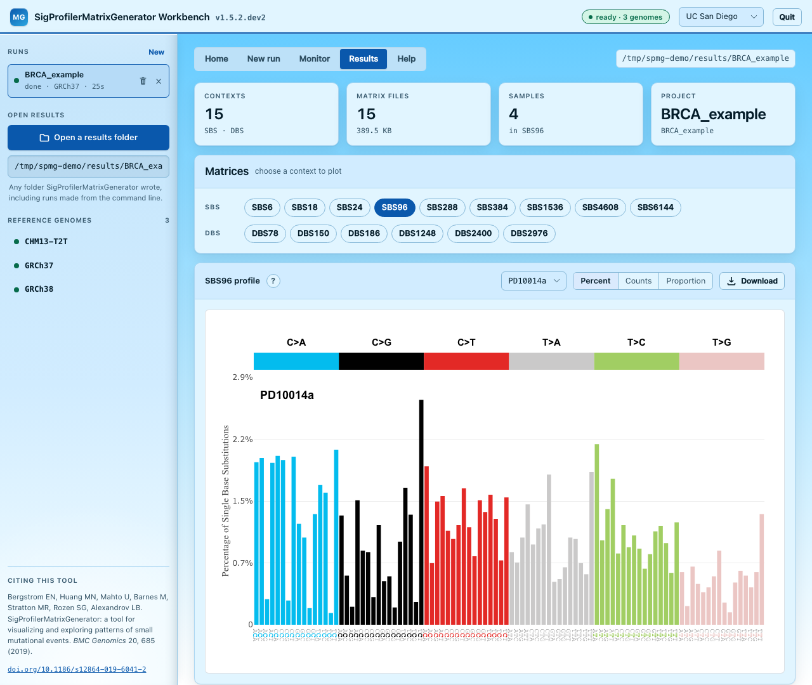
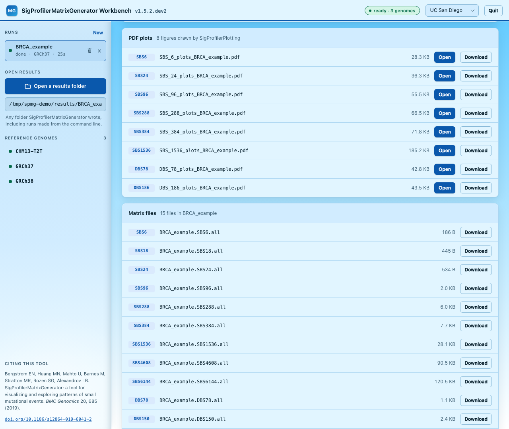
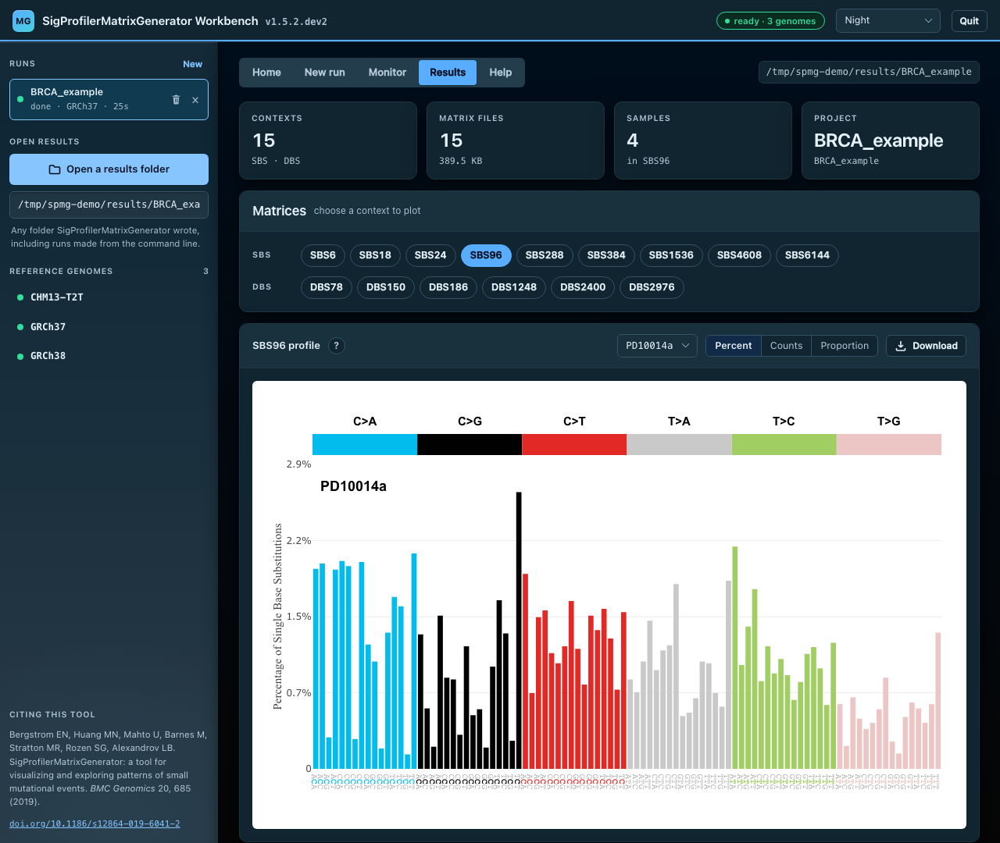

# Graphical Interface (Workbench)

The **SigProfilerMatrixGenerator Workbench** generates mutational matrices from
your browser, without writing code. Choose a folder of variant calls and the
reference genome they were called against, start the run, follow its progress,
and plot the resulting matrices sample by sample.

Everything runs on your own computer: the Workbench is a small server on this
machine, and your browser is its window. Your data never leaves the computer.
It runs the same function as Python and the command line, with the same
defaults, so a run started here writes exactly the files described in
[Output Overview](Using-the-Tool-Output.md).

<figure class="screenshot" markdown="span">
  
  <figcaption>The Home page: what the tool takes, what it gives back, and an example to try.</figcaption>
</figure>

<div class="grid cards" markdown>

-   :material-folder-open-outline:{ .lg .middle } __Variant calls in__

    ---

    A folder of VCF, MAF or simple text files. The format, samples, mutations
    and indels are reported before anything runs.

-   :material-dna:{ .lg .middle } __The right genome__

    ---

    Install reference genomes from the Workbench. It warns when the calls name
    a different assembly from the one chosen.

-   :material-progress-clock:{ .lg .middle } __Follow the run__

    ---

    Live progress and log. Mutations the run had to skip are counted by
    reason.

-   :material-chart-bar:{ .lg .middle } __Matrices out__

    ---

    Every matrix charted sample by sample, the PDF plots, and every file to
    download.

</div>

## Install and start

The Workbench comes with SigProfilerMatrixGenerator. Download or clone the
[repository](https://github.com/SigProfilerSuite/SigProfilerMatrixGenerator)
and start it from that folder. The only requirement is **Python 3.9 or newer**.

=== "macOS"

    1. If Python 3 is not installed, install it from
       [python.org](https://www.python.org/downloads/macos/) (or with Homebrew
       or conda).
    2. In the SigProfilerMatrixGenerator folder, double-click
       **`launch_web.command`**.
    3. The first time, macOS may say it cannot verify the file: right-click it,
       choose **Open**, then **Open** again. macOS remembers this choice.
    4. A Terminal window opens and sets up the Workbench's private Python
       environment. This takes a few minutes the first time and is skipped
       afterwards.
    5. The Workbench opens in your browser. Keep the Terminal window open while
       you use it; **Quit** in the Workbench's top bar stops it.

=== "Windows"

    1. If Python 3 is not installed, install it from
       [python.org](https://www.python.org/downloads/windows/). Tick **Add
       python.exe to PATH** in the installer (the `py` launcher it installs also
       works).
    2. In the SigProfilerMatrixGenerator folder, double-click
       **`launch_web.bat`**.
    3. If Windows SmartScreen appears, click **More info**, then **Run anyway**.
    4. A console window opens and sets up the Workbench's private Python
       environment. This takes a few minutes the first time and is skipped
       afterwards.
    5. The Workbench opens in your browser. Keep the console window open while
       you use it; **Quit** in the Workbench's top bar stops it.

=== "Linux"

    In a terminal, in the SigProfilerMatrixGenerator folder:

    ```bash
    ./launch_web.sh
    ```

    The first start sets up the private Python environment (a few minutes),
    then opens the Workbench in your browser. `./launch_web.sh` also works in
    Terminal on macOS.

=== "Installed with pip"

    If SigProfilerMatrixGenerator is already installed in a Python environment,
    either command starts the Workbench from that environment, with no separate
    setup:

    ```bash
    SigProfilerMatrixGenerator web
    sigprofilermatrixgenerator-web
    ```

The browser opens `http://127.0.0.1:<port>/`. A free port is picked on every
start, and the window that started the Workbench prints the address. Starting it
while it is already running prints the address of the running one instead of
starting a second.

### What gets installed, and where

| What | Where | Removed by the uninstaller |
|---|---|---|
| A private Python environment with SigProfilerMatrixGenerator and its dependencies | `.venv-dashboard`, inside the SigProfilerMatrixGenerator folder | yes |
| Run records: each run's settings, log and result | `~/.cache/sigprofilermatrixgenerator` (macOS, Linux), `%LOCALAPPDATA%\SigProfilerMatrixGenerator` (Windows) | yes |
| Reference genomes installed through the Workbench | `SigProfilerMatrixGenerator/references/chromosomes/tsb`, inside the SigProfilerMatrixGenerator folder (inside the installed package when started with pip), unless you set a **Genome install folder** | only if you agree, since runs from Python or the command line in this folder use them too |
| Your matrices | each run's output folder | no |
| Downloaded packages, kept so later installs are quicker | uv's cache: `~/.cache/uv` (macOS, Linux), `%LOCALAPPDATA%\uv\cache` (Windows); or pip's cache if pip was used | no: `uv cache clean` (or `pip cache purge`) empties it |

Nothing else is installed: no system files, services or registry entries. The
launcher reinstalls into its environment only when `setup.py` or
`pyproject.toml` changes, for example after updating the repository.

The launcher installs with [uv](https://docs.astral.sh/uv/), which downloads
and installs packages in parallel and is much quicker than pip: on a laptop, a
reinstall from its cache takes seconds instead of half a minute. It uses the
`uv` already on your PATH if there is one; otherwise it first adds uv to the
Workbench's own environment. If uv cannot be added or cannot install, the
launcher says so and uses pip instead. To always use pip, for example behind a
network that only allows pip's configured package mirror, set the environment
variable `SPMG_WEB_INSTALLER=pip`.

### Launch options

| Option | Meaning |
|---|---|
| `--no-launch` | Start without opening a browser tab |
| `--stop` | Stop the running Workbench, and any run it started, then exit |
| `--volume PATH` | Folder where reference genomes are installed (same as the CLI's `--volume`) |
| `--reinstall` | Force a fresh install into `.venv-dashboard` (launcher scripts only) |

```bash
./launch_web.sh --no-launch          # start without opening a tab
./launch_web.sh --stop               # stop it from another terminal
SigProfilerMatrixGenerator web --volume /data/genomes
```

## Home

The Workbench opens on a page that introduces the tool: what it takes, what it
gives back, and how it works, in five steps from reading the calls to plotting
the matrices. Three buttons lead on:

- **Start a new run** opens the New run tab.
- **Try the BRCA example** (or the GRCh38 test set, whichever can run sooner)
  fills in a complete run. The line under it says how long it takes, or that
  its genome is installed first.
- **Open results** opens any folder SigProfilerMatrixGenerator wrote.

Once you have made runs, the last four are listed at the bottom of the page:
a finished one opens its results, any other its progress. The Workbench's name,
at the top left, always brings you back here.

## Setting up a run

The **New run** tab has an **Examples** card and four numbered cards. Each
number turns green once its card is complete, and **Start run** stays disabled
until every card is.

<figure class="screenshot" markdown="span">
  
  <figcaption>Examples, then the input: a folder of calls, read and summarised before anything runs.</figcaption>
</figure>

!!! tip "Try an example first"
    Two examples that ship with SigProfilerMatrixGenerator can be filled in
    with one click. Each writes to its own folder under
    `~/SigProfilerMatrixGenerator_example/`.

    | Example | Input | Genome |
    |---|---|---|
    | **BRCA example** | Simple text calls for four breast cancer genomes | GRCh37 |
    | **GRCh38 test set** | 9,631 simulated substitutions in one genome (VCF) | GRCh38 |

    The GRCh38 test set doubles as a check of your installation: its SBS96
    matrix should match, channel for channel, the expected matrix that ships
    with the package (`scripts/Benchmark/GRCh38_bench_orig_96.txt`). Tick
    **PDF plots** to see SigProfilerPlotting's figures for it too. An example
    whose genome is not installed yet installs it first (see
    [Reference genome](#3-reference-genome)).

### 1. Input

Click **Choose the input folder**, or paste a folder path and press Enter.
Every file in the folder is read, so keep one cohort, in one format, per
folder.

| Extension | Format | Samples |
|---|---|---|
| `.vcf` | VCF 4.x | One file per sample, named after the file |
| `.maf` | MAF | From the `Tumor_Sample_Barcode` column; one file can hold many samples |
| `.txt` | SigProfiler simple text | From the second column; one file can hold many samples |

As soon as a folder is chosen, the Workbench reads it and reports the format,
the number of samples, the number of mutation calls (and how many are
insertions or deletions) and the number of files, before anything runs. It also
catches the usual mistakes:

- **A single file instead of a folder.** SigProfilerMatrixGenerator reads
  whole folders, so the Workbench names the folder to choose instead.
- **Mixed formats.** A folder holding both `.vcf` and `.maf` files is refused.
  Put each format in its own folder.
- **Other files.** Files that are not mutation calls (a `README`, say) are
  listed with a warning, since the run would try to read them too.

Files starting with `__` or `.DS` are skipped, as SigProfilerMatrixGenerator
itself skips them. A folder that holds no files but has an `input/` subfolder,
the layout of older projects, is read from `input/`.

### 2. Project

The **project name** becomes part of every file name, as in
`BRCA.SBS96.all`. It is filled in from the input folder's name until you type
your own.

The **output folder** is where the matrices go:

- Left blank, they go to an `output` folder inside the input folder.
- Set, they go straight into that folder.

Either way, each type of mutation found gets its own subfolder (`SBS/`,
`DBS/`, `ID/`), with run logs in `logs/` and, when **PDF plots** is ticked,
SigProfilerPlotting's figures in `plots/`. SigProfilerMatrixGenerator also
keeps a copy of the input files it read, in an `input/` folder: inside the
input folder by default, or inside the output folder when one is set.

#### An output folder that already holds results

SigProfilerMatrixGenerator does not clear an output folder before writing to
it. A second run into the same folder rewrites the files it makes and leaves
the rest: plots from a run that drew them, ID89 and ID476 from a run that
asked for them, everything from a run that failed. Those files would then sit
beside the new ones as if they belonged to them.

<figure class="screenshot" markdown="span">
  
  <figcaption>A folder with earlier results: the run waits until you choose a new folder or to replace them.</figcaption>
</figure>

So when the output folder already holds results, the Project card says so and
the run does not start until you choose one of:

- **Use a new folder**, which fills in the next free name beside it
  (`BRCA_example_2`, `BRCA_example_3`, ...).
- **Replace the earlier results**, which deletes them when the run starts.
  Only what SigProfilerMatrixGenerator wrote is deleted: its matrices, plots,
  strand bias tables, logs and its copies of the input. Anything else in the
  folder stays. This cannot be undone. It is not offered when your input calls
  are inside the output folder.

### 3. Reference genome

Choose the assembly your variants were called against. The card says whether
it is installed:

- **Install it now** starts the download in the background. The genome is
  large (about 3 GB for a human assembly) and is downloaded once.
- With **If it is not installed yet, install it when the run starts** ticked
  (the default), a run installs a missing genome as its first step.

<figure class="screenshot" markdown="span">
  
  <figcaption>Calls that name GRCh37, with CHM13-T2T chosen: the card warns and offers to switch. Below, the matrix options.</figcaption>
</figure>

Getting the genome right matters. Every mutation is checked against the
genome's reference base, so calls made on GRCh37 and run against GRCh38 or
CHM13-T2T mostly fail that check, and the run stops once more than 30% of
mutations are skipped. When the calls name their assembly (a VCF's
`##reference` or `##assembly` header, the genome column of simple text, or a
MAF's `NCBI_Build`), the card warns if a different genome is chosen and offers
to switch. The BRCA example, for instance, names GRCh37. Calls that do not name
an assembly are not checked.

Installed genomes are also listed in the sidebar; clicking one selects it. The
status describes the genome install folder the run will use: the one set under
**Advanced** in the Matrices card if there is one, otherwise the folder the
Workbench was started with. Changing that field (press Enter, or use Browse)
updates the status straight away.

!!! note
    The genome card only checks that each of the genome's files is present.
    A run checks the files against their expected checksums before it starts.
    If they do not match, the run downloads the genome again when automatic
    install is ticked; otherwise it stops and says the files do not match.

### 4. Matrices

SigProfilerMatrixGenerator writes the standard matrices for each type of
mutation present in your calls: SBS for single base substitutions, DBS for
doublet base substitutions and ID for small insertions and deletions. A cohort
with no doublet substitutions, for example, gets no DBS matrices. The options
add to the standard set:

| Option | What it does | Python / CLI equivalent |
|---|---|---|
| PDF plots | SigProfilerPlotting draws every SBS, DBS and ID matrix the run writes, one page per sample, into `plots/`. Adds time for large cohorts | `plot=True` / `--plot` |
| Exome only | Keeps mutations inside the exome (with a 100 bp cushion). Files end in `.exome` | `exome=True` / `--exome` |
| Strand bias test | Tests transcriptional strand bias for SBS24, SBS384 and SBS6144; results go to `TSB/` | `tsb_stat=True` / `--tsb_stat` |
| ID89, ID476 | Adds the Koh et al. (2025) indel matrices; ID83 is unchanged | `indel_contexts=["89", "476"]` / `--indel_contexts 89 476` |
| Region BED file (Advanced) | Keeps only these regions; the file needs a header line. Files end in `.region` | `bed_file=` / `--bed_file` |
| Genome install folder (Advanced) | Where reference genomes are installed | `volume=` / `--volume` |

Calls without insertions or deletions, such as the BRCA example, give no ID
matrices: no ID83, and ID89 and ID476 come out all zeros. The card says so
when ID89 or ID476 is ticked for such calls.

See [ID89 and ID476](ID89-ID476.md) for the indel classifications, and
[Output Overview](Using-the-Tool-Output.md) for every file a run writes.

Click **Start run**. The summary beside the button shows the project, the
number of samples and the genome the run will use.

## Following a run

Starting a run opens the **Monitor** tab:

<figure class="screenshot" markdown="span">
  
  <figcaption>A run generating its matrices: the steps, the details and the run's own log.</figcaption>
</figure>

- **Progress** in three steps: checking the reference genome (and installing
  it if needed), generating the matrices, and writing the summary. A genome
  install shows as a single step.
- **Details:** project, genome, input folder, output folder and start time.
- **Log:** the run's own output as it is written. Untick **follow** to scroll
  back while it runs.
- **Stop** ends the run. Files already written stay where they are.

When the run finishes, **Open results** shows its matrices. If it fails, the
reason is shown above the log, and the full traceback is in the log.

SigProfilerMatrixGenerator skips mutations it cannot place (a reference base
that does not match the genome, a position past the end of a chromosome, and
so on) and lists each one in its own log, in the output folder's `logs/`, not
in the log shown here. When a run skipped any, the Monitor tab counts them by
reason and names that log file.

A run that fails may still have written matrices or plots before it stopped.
The Monitor tab says so: do not use them. Run again into the same folder and
choose **Replace the earlier results**, or delete the failed run.

Each run is a separate process, so a long run never slows the page, and runs
keep their records after the Workbench is restarted. Every run, past and
present, is listed in the sidebar under **Runs**; the Monitor tab shows a count
of the ones still in progress.

### Removing and deleting runs

A finished run has two buttons, on its row in the Runs list (shown when you
point at it) and in the Monitor tab:

| Button | What it does |
|---|---|
| **×** (Remove from list) | Takes the run off the list. Its results stay on disk, and **Undo** in the message that follows brings it back. |
| Bin (Delete) | Deletes the run and, after asking, its results: what SigProfilerMatrixGenerator wrote in its output folder. Other files in that folder stay, and the folder itself goes only when nothing else is left in it. This cannot be undone: the files do not go to the Trash or Recycle Bin. |

<figure class="screenshot" markdown="span">
  
  <figcaption>Delete asks first, and says exactly what goes: the files, their size and the folder.</figcaption>
</figure>

If a later run wrote to the same output folder, deleting the earlier run
removes only its entry and leaves the files alone, since they cannot be told
apart. A genome install can only be removed from the list; that never
uninstalls the genome. A run still in progress has neither button: stop it
first.

## Exploring results

Open a finished run from the Monitor tab or from Home, or click **Open a
results folder** in the sidebar and choose the folder a run wrote its matrices
into (the one holding the `SBS`, `DBS` and `ID` subfolders). That includes
folders written earlier by the Python function or the command line. It only
reads the folder.

This is not the **Output folder** field of a new run, which sets where a run
will write.

<figure class="screenshot" markdown="span">
  
  <figcaption>The BRCA example's results: one button per matrix, and the SBS96 profile of one sample, in percent.</figcaption>
</figure>

The **Results** tab shows:

- **Tiles:** the number of contexts and matrix files, the number of samples,
  and the project.
- **Matrices:** one button per context found (SBS96, DBS78, ID83, and so on),
  grouped into SBS, DBS and ID.
- **The profile** of the selected context, for one sample at a time:
    - choose the **sample** from the list;
    - switch between **Percent** (the default, for every type of matrix),
      **Counts** and **Proportion**. Percent and proportion rescale each sample
      to its own total, which makes samples with different mutation burdens
      comparable;
    - the **?** button explains what the chart shows and how to read it;
    - **Download** saves the matrix file;
    - the camera button above the chart saves the figure as SVG, named after
      the project, context and sample.
- **PDF plots:** the figures SigProfilerPlotting drew, when the run had
  **PDF plots** ticked. **Open** shows a PDF in a new browser tab;
  **Download** saves it.
- **Matrix files:** every matrix in the folder, with its size and a download
  link.

<figure class="screenshot" markdown="span">
  
  <figcaption>The PDF plots SigProfilerPlotting drew, and every matrix file, each ready to open or download.</figcaption>
</figure>

Above the matrices, the Results tab warns about files that should not be read
as one run's results:

- **From an earlier run.** For a folder written by runs started in the
  Workbench, matrices and plots older than the latest run there are marked
  "earlier".
- **Older than its matrix.** A PDF plot older than the matrix it shows was
  drawn by an earlier run, so it may not match. This works for folders written
  from the command line too.
- **Empty.** A matrix whose counts are all zero (ID89 for calls without
  indels, say) is marked empty and is not drawn.
- **From a failed run.** When the newest files come from a run that failed.

Charts are drawn by SigProfilerPlotting's own renderers, the same ones its
dashboard uses.

!!! note "Requirements for charts"
    Charts need SigProfilerPlotting 1.5.0 or later. With an older version the
    Results tab still lists the matrices and lets you download them, and says
    why the charts are missing. To upgrade:

    ```bash
    pip install --upgrade sigProfilerPlotting
    ```

SBS1536 and SBS4608 use a multi-panel layout that the Results tab does not
draw. Download the matrix and open it in the SigProfilerPlotting dashboard to
view it.

## Themes

The menu in the top bar switches between four themes: **UC San Diego**,
**UAlbany** and **SigProfilerSuite** are light, **Night** is dark. The choice
is remembered by your browser. Until one is chosen, the Workbench follows your
system's light or dark setting. Charts stay on a white panel in every theme,
so the standard SigProfiler colours read the same everywhere.

<figure class="screenshot" markdown="span">
  
  <figcaption>The Night theme. Charts keep their white panel.</figcaption>
</figure>

## Stopping the Workbench

Any of these stops the Workbench, together with any run still in progress:

- the **Quit** button in the top bar, which asks you to confirm and says if a
  run is still in progress;
- `./launch_web.sh --stop` (or `launch_web.bat --stop`, or
  `SigProfilerMatrixGenerator web --stop`) from another terminal;
- Ctrl+C in the terminal the Workbench was started from.

Matrices already written stay where they are.

## Uninstall

The Workbench installs nothing outside the places listed under
[What gets installed, and where](#what-gets-installed-and-where).

### With a double-click

1. Click **Quit** in the Workbench. (The uninstaller refuses to run while the
   Workbench or one of its runs is still going.)
2. In the SigProfilerMatrixGenerator folder, double-click
   **`uninstall_web.command`** (macOS) or **`uninstall_web.bat`** (Windows).
   On Linux, run `./uninstall_web.sh`. The same first-time prompts as for
   starting may appear: right-click and **Open** on macOS; **More info**, then
   **Run anyway** on Windows.
3. It lists what it will remove and asks before doing anything:

    ```text
      SigProfilerMatrixGenerator Workbench uninstaller
      ------------------------------------------------
      This removes:
        - the Python environment /path/to/SigProfilerMatrixGenerator/.venv-dashboard (600M)
        - the records of 3 run(s) in ~/.cache/sigprofilermatrixgenerator (settings and logs, not matrices)

      It keeps your matrices (each run's output folder) and this folder (/path/to/SigProfilerMatrixGenerator).

      Remove them? Type y and press Enter:
    ```

4. Type **y** and press Enter.
5. If reference genomes were installed in this folder, it then lists them and
   asks about them separately, since runs from Python or the command line in
   this folder use them too and each takes a while to download again:

    ```text
      Reference genomes installed in this folder: GRCh37 GRCh38 (5.8G)
        in /path/to/SigProfilerMatrixGenerator/SigProfilerMatrixGenerator/references/chromosomes/tsb
      Runs from Python or the command line in this folder use them too, and each one
      takes a while to download again.
      Remove these genomes too? Type y and press Enter, or just Enter to keep them:
    ```

    Press Enter to keep them, or type **y** to remove them too. Only the
    genomes go: the files that ship with SigProfilerMatrixGenerator stay.

To remove the rest, delete the SigProfilerMatrixGenerator folder and, if you no
longer need them, your matrices. Double-clicking `launch_web.command` or
`launch_web.bat` again later sets everything up anew.

From a terminal, `./uninstall_web.sh --yes` (or `uninstall_web.bat --yes`)
removes the environment and run records without asking and keeps the genomes;
add `--genomes` to remove the genomes too.

### By hand

1. Click **Quit** in the Workbench.
2. Delete the `.venv-dashboard` folder inside the SigProfilerMatrixGenerator
   folder.
3. Delete the run records: `~/.cache/sigprofilermatrixgenerator` on macOS and
   Linux, `%LOCALAPPDATA%\SigProfilerMatrixGenerator` on Windows. They hold
   each run's settings and log, not its matrices.
4. If you no longer need them, delete the genome folders (one per genome) in
   `SigProfilerMatrixGenerator/references/chromosomes/tsb`.

Your matrices stay in each run's output folder.

## Security

The Workbench is meant for one person on their own computer. It listens only
on this machine (`127.0.0.1`) and has no login, so it protects itself in other
ways:

- It answers only requests addressed to this machine by name (`127.0.0.1` or
  `localhost`), which stops a website from reaching it through DNS tricks.
- Anything that acts (starting or stopping a run, installing a genome,
  opening a file picker, quitting) must come from the Workbench's own page:
  from exactly its address and port, and carrying a secret written into that
  page when it starts. A website, or a page served by another program on this
  computer, can send requests to the Workbench but cannot read its page, so it
  cannot supply the secret.
- Every other request only reads (the page itself, run progress, matrix
  files), and your browser does not let other websites see the replies.

The Workbench can read any folder you can, and starts processes on your
behalf, so do not expose it on a network.

## Troubleshooting

**"Python 3 was not found."**
Install Python 3.9 or newer (see [Install and start](#install-and-start)),
then double-click the launcher again.

**macOS says the file cannot be opened, or is from an unidentified developer.**
Right-click the file, choose **Open**, then **Open** again.

**Windows protected your PC.**
Click **More info**, then **Run anyway**.

**The genome shows as not installed.**
Install it from the genome card, or from a terminal:
`SigProfilerMatrixGenerator install GRCh38`. If your genomes live elsewhere,
set the genome install folder under Advanced and press Enter, or start the
Workbench with `--volume`. If the `SIGPROFILERMATRIXGENERATOR_VOLUME`
environment variable is set, it takes precedence over both.

**The run failed: "More than 30% of mutations were skipped".**
Look at the reasons the Monitor tab lists. If most are "The reference base
does not match the reference genome", the calls were made against a different
genome from the one chosen: choose the genome they were called against and run
again.

**The PDF plots do not match the matrices.**
They were drawn by an earlier run into the same folder; the Results tab marks
them. Run again with **PDF plots** ticked, choosing **Replace the earlier
results**, or use a new folder.

**There is no ID83, only ID89 and ID476 (all zeros).**
The calls hold no insertions or deletions. The Input card shows how many
there are.

**The folder picker does not open (Linux).**
The picker needs `zenity`, `kdialog` or a Python with Tkinter. Without them,
paste the path into the box under the button instead.

**The uninstaller says the Workbench is still running.**
Click **Quit** in the Workbench (or run `./launch_web.sh --stop`, or
`launch_web.bat --stop`), then run it again.

**The page stopped responding after a restart.**
Each start uses a new address. Use the address the launcher printed, or run
the launcher again: if the Workbench is already running, it prints that
address.

**Charts are missing on the Results tab.**
Upgrade SigProfilerPlotting to 1.5.0 or later (see above).

**Where are the run records?**
In `~/.cache/sigprofilermatrixgenerator/jobs` on macOS and Linux, and
`%LOCALAPPDATA%\SigProfilerMatrixGenerator\jobs` on Windows. Each run's folder
holds its settings, its log and its result. The matrices themselves are only
in the run's output folder.
